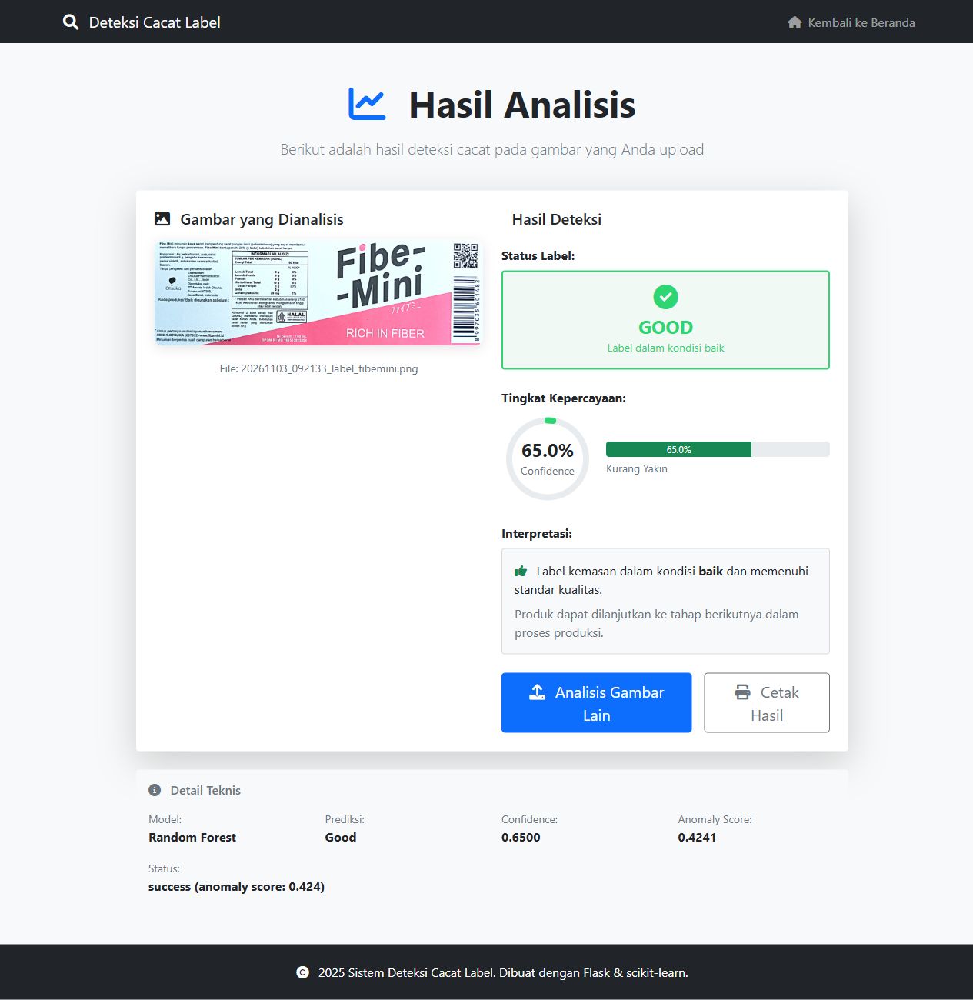
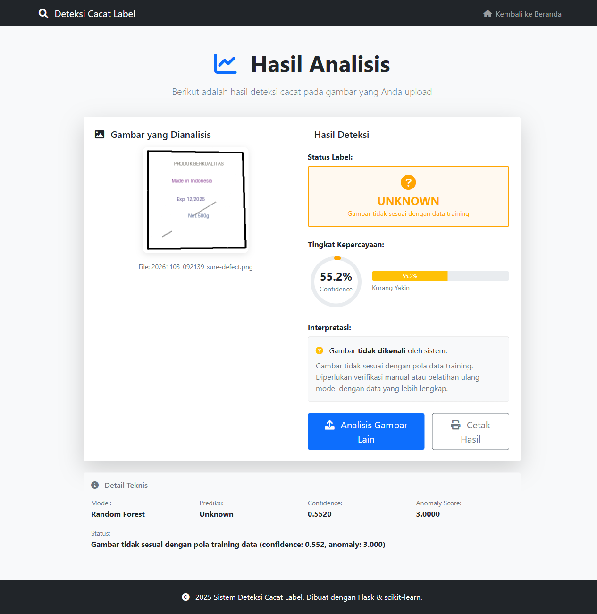
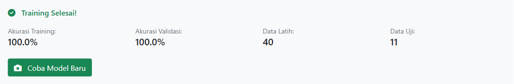

# Dokumentasi Akurasi Model

Dokumen ini merangkum metodologi, hasil, dan analisis evaluasi model deteksi
cacat label kemasan. Angka di bawah dihasilkan langsung dari dataset yang ada di
repositori menggunakan `python evaluate_model.py`.

- **Tanggal evaluasi:** 3 November 2026
- **Model:** Random Forest (`n_estimators=100`, `random_state=42`)
- **File model:** `models/defect_detection_model.pkl`
- **Library:** scikit-learn 1.9.1, NumPy 2.5.4, Python 3.13

## 1. Ringkasan Hasil

| Metrik | Nilai |
|---|---|
| Akurasi cross-validation (5-fold) | **0.9800 ± 0.0400** |
| Precision (weighted) | **0.9833 ± 0.0333** |
| Recall (weighted) | **0.9800 ± 0.0400** |
| F1-score (weighted) | **0.9798 ± 0.0404** |
| Akurasi out-of-fold (agregat) | **0.9804** (50/51 benar) |
| Interval kepercayaan 95% (Wilson) | **[0.8970, 0.9965]** |
| Baseline majority class | 0.5098 |
| Akurasi pada data training (resubstitution) | 1.0000 (optimistis) |

Model salah mengklasifikasikan **1 dari 51** sampel pada evaluasi out-of-fold:
satu gambar *good* diprediksi *defect*. Tidak ada gambar *defect* yang lolos
sebagai *good* (false negative = 0).

## 2. Dataset

| Kategori | Jumlah |
|---|---|
| Good | 26 |
| Defect | 25 |
| **Total** | **51** |

Dataset dibangkitkan oleh `generate_from_base.py` dari satu gambar label asli
(`static/base-data/label_fibemini.png`):

- **Good:** gambar asli + 25 variasi ringan (brightness, contrast, warna).
- **Defect:** 25 variasi dengan cacat sintetis (wrinkle, stain, scratch, tear,
  blur, fade, misprint).

Setiap gambar di-resize ke **64×64** piksel, lalu diekstraksi menjadi **15 fitur**:

1. Mean R, G, B (3)
2. Standar deviasi R, G, B (3)
3. Brightness dan contrast (2)
4. Edge density horizontal dan vertikal (2)
5. Lima bin pertama histogram grayscale (5)

## 3. Metodologi Evaluasi

### 3.1 5-fold stratified cross-validation

- Seluruh 51 sampel dibagi menjadi 5 fold dengan proporsi kelas seimbang
  (`StratifiedKFold`, `shuffle=True`, `random_state=42`).
- Setiap fold dilatih pada 4/5 data dan diuji pada 1/5 data.
- Model yang dievaluasi adalah Random Forest baru dengan hyperparameter sama
  seperti model produksi, agar hasil tidak bergantung pada satu split saja.
- Metrik dilaporkan sebagai **mean ± standar deviasi** antar-fold.

### 3.2 Confusion matrix out-of-fold

Prediksi dari setiap fold digabung sehingga setiap sampel mendapat prediksi
dari model yang **tidak** melihat sampel tersebut saat training.

### 3.3 Resubstitution

Model tersimpan juga diuji pada data training yang sama. Angka ini dilaporkan
hanya sebagai pembanding, bukan ukuran performa sebenarnya.

### 3.4 Gambar uji eksternal

Dua gambar di `static/base-data/` diuji melalui alur prediksi aplikasi
(preprocessing → fitur → model → threshold).

## 4. Hasil per Fold

| Fold | Accuracy | Precision | Recall | F1 |
|---|---|---|---|---|
| 1 | 1.0000 | 1.0000 | 1.0000 | 1.0000 |
| 2 | 0.9000 | 0.9167 | 0.9000 | 0.8990 |
| 3 | 1.0000 | 1.0000 | 1.0000 | 1.0000 |
| 4 | 1.0000 | 1.0000 | 1.0000 | 1.0000 |
| 5 | 1.0000 | 1.0000 | 1.0000 | 1.0000 |
| **Mean ± std** | **0.9800 ± 0.0400** | **0.9833 ± 0.0333** | **0.9800 ± 0.0400** | **0.9798 ± 0.0404** |

Satu-satunya kesalahan terjadi pada fold 2.

## 5. Confusion Matrix (Out-of-Fold)

|  | Prediksi good | Prediksi defect |
|---|---|---|
| **Aktual good** | 25 (TN) | 1 (FP) |
| **Aktual defect** | 0 (FN) | 25 (TP) |

### Classification report

| Kelas | Precision | Recall | F1-score | Support |
|---|---|---|---|---|
| good | 1.0000 | 0.9615 | 0.9804 | 26 |
| defect | 0.9615 | 1.0000 | 0.9804 | 25 |
| **macro avg** | 0.9808 | 0.9808 | 0.9804 | 51 |
| **weighted avg** | 0.9811 | 0.9804 | 0.9804 | 51 |

Interpretasi:

- **Recall defect = 1.0000** → tidak ada produk cacat yang lolos sebagai good
  pada data evaluasi.
- **Precision defect = 0.9615** → sekitar 3,8% prediksi defect adalah false
  positive (satu gambar good).
- Untuk quality control, recall defect yang tinggi lebih penting daripada
  precision, karena melewatkan cacat biasanya lebih mahal daripada inspeksi
  ulang.

## 6. Analisis

### 6.1 Dibandingkan baseline

Baseline *majority class* (selalu memprediksi kelas terbanyak, yaitu `good`)
hanya mencapai **0.5098**. Model mencapai **0.9804**, atau **+0.4706 poin**
(sekitar 96% pengurangan error dibanding baseline).

Namun baseline ini sangat lemah dan dataset sangat kecil, sehingga angka
tersebut tidak boleh dibaca sebagai jaminan performa di produksi.

### 6.2 Interval kepercayaan

Dengan 50 dari 51 prediksi benar, interval kepercayaan Wilson 95% adalah
**[0.8970, 0.9965]**. Artinya, pada distribusi data seperti ini, akurasi model
masih dapat berada di kisaran **90%–99,7%**. Satu kesalahan saja menggeser
akurasi sekitar 2 poin persentase, tanda bahwa ukuran sampel masih terlalu kecil
untuk estimasi yang presisi.

### 6.3 Analisis kesalahan

Satu-satunya kesalahan out-of-fold:

| Item | Nilai |
|---|---|
| File | `good/fibemini_good_001_20261103_083335.png` |
| Label aktual | good |
| Prediksi (fold) | defect |
| Confidence | 1.000 |
| Anomaly score | 0.424 |

File tersebut adalah **gambar dasar asli** (`label_fibemini.png`) yang disimpan
sebagai sampel good pertama. Ketika gambar itu dikeluarkan dari data training
pada fold 2, model justru sangat yakin memprediksinya sebagai defect.

Sebagai pembanding, model produksi (yang **memasukkan** gambar tersebut dalam
training) memprediksi gambar yang sama sebagai **good** dengan confidence
**0.650**. Perbedaan ini menunjukkan:

- Model sangat sensitif terhadap komposisi dataset dan keberadaan gambar acuan.
- Variasi good sintetis belum cukup beragam untuk membentuk batas keputusan
  yang stabil.
- Akurasi 98% sebagian ditentukan oleh kebetulan pembagian fold; performa pada
  data baru bisa lebih rendah.

### 6.4 Feature importance

| Fitur | Importance | % |
|---|---|---|
| mean_B | 0.1530 | 15.3% |
| mean_G | 0.1208 | 12.1% |
| hist_bin_3 | 0.1196 | 12.0% |
| hist_bin_4 | 0.1191 | 11.9% |
| brightness | 0.0856 | 8.6% |
| std_G | 0.0772 | 7.7% |
| mean_R | 0.0600 | 6.0% |
| edge_horizontal | 0.0597 | 6.0% |
| std_R | 0.0528 | 5.3% |
| std_B | 0.0528 | 5.3% |
| hist_bin_2 | 0.0299 | 3.0% |
| edge_vertical | 0.0252 | 2.5% |
| contrast | 0.0241 | 2.4% |
| hist_bin_1 | 0.0202 | 2.0% |
| hist_bin_0 | 0.0000 | 0.0% |

**Top-3:** `mean_B` (15.3%), `mean_G` (12.1%), `hist_bin_3` (12.0%).

Analisis:

- Fitur **warna dan histogram mendominasi** keputusan model. Tiga fitur teratas
  menyumbang **39,4%**, dan seluruh fitur warna/histogram menyumbang lebih dari
  setengah importance.
- Fitur **edge hanya menyumbang 8,5%** (horizontal 6,0% + vertikal 2,5%).
  Artinya model lebih mengandalkan perubahan warna/kecerahan global daripada
  bentuk atau tepi cacat.
- `hist_bin_0` tidak pernah dipakai (0%). Ini masuk akal karena area gelap
  ekstrem jarang muncul pada label.
- Implikasi: cacat lokal yang tidak mengubah statistik warna global (mis.
  goresan tipis atau cacat halus) berpotensi sulit dideteksi. Model juga rentan
  terhadap perubahan pencahayaan dan white balance.

### 6.5 Confidence per kelas

Confidence dihitung setelah penalti anomaly, sama seperti di aplikasi.

| Kelas | Mean | Median | Min | Max |
|---|---|---|---|---|
| good | 0.883 | 0.905 | 0.550 | 1.000 |
| defect | 0.912 | 0.930 | 0.740 | 1.000 |

Analisis:

- Prediksi **defect lebih percaya diri** (minimum 0.740) dibanding good
  (minimum 0.550).
- Ada satu sampel good dengan confidence **0.550**, di bawah ambang 0.6. Sampel
  ini tetap terklasifikasi benar, tetapi akan ditandai **UNKNOWN** dan masuk
  review manual. Ini perilaku yang aman untuk quality control.
- Tidak ada sampel defect dengan confidence di bawah 0.74, sehingga tidak ada
  cacat yang terlewat hanya karena confidence rendah.

### 6.6 Sensitivitas threshold

#### Confidence threshold (anomaly threshold tetap 1.5)

| Threshold | Unknown (dari 51) | False unknown* |
|---|---|---|
| 0.50 | 0 | 0 |
| 0.55 | 0 | 0 |
| **0.60 (default)** | **1** | **1** |
| 0.65 | 1 | 1 |
| 0.70 | 2 | 2 |
| 0.80 | 9 | 9 |

\*False unknown = sampel yang sebenarnya terklasifikasi benar tetapi ditandai
UNKNOWN karena confidence rendah (berarti perlu review manual, bukan salah
klasifikasi).

Analisis:

- Threshold 0.6 hanya menandai 1 dari 51 sampel (2%) sebagai UNKNOWN.
- Menaikkan threshold ke 0.8 menandai 9 sampel (17,6%) — terlalu agresif untuk
  dataset ini dan akan menambah beban review manual.
- Menurunkan ke 0.5–0.55 tidak menandai satu pun sampel; risiko cacat lolos
  meningkat. **0.6 adalah titik seimbang untuk dataset saat ini.**

#### Anomaly threshold (confidence threshold tetap 0.6)

| Threshold | Unknown (dari 51) | False unknown* |
|---|---|---|
| 1.00 | 3 | 3 |
| 1.25 | 1 | 1 |
| **1.50 (default)** | **1** | **1** |
| 2.00 | 1 | 1 |
| 2.50 | 1 | 1 |
| 3.00 | 1 | 1 |

Analisis:

- Anomaly score sampel training good berkisar 0.424–1.098, sedangkan defect
  0.421–0.455. Threshold 1.0 mulai menandai 2 sampel good tambahan sebagai
  outlier.
- Mulai 1.25 ke atas, hasilnya stabil. Threshold 1.5 cukup konservatif dan tidak
  menghukum data in-distribution.
- Anomaly detection baru benar-benar aktif untuk gambar di luar distribusi:
  `sure-defect.png` mendapat skor **3.0** dan langsung menjadi UNKNOWN.

### 6.7 Implikasi biaya kesalahan

| Jenis kesalahan | Jumlah | Dampak |
|---|---|---|
| False negative (defect → good) | 0 | Produk cacat lolos — paling mahal |
| False positive (good → defect) | 1 | Inspeksi ulang — biaya sedang |

Model saat ini **konservatif**: tidak ada cacat yang lolos, dengan konsekuensi
satu label baik masuk inspeksi ulang. Untuk lini produksi, trade-off ini umumnya
dapat diterima. Jika biaya inspeksi ulang lebih mahal daripada risiko cacat
lolos, threshold dapat dilonggarkan — tetapi keputusan itu harus berdasarkan
data produksi nyata, bukan dataset sintetis ini.

## 7. Anomaly Score

Ambang `ANOMALY_THRESHOLD = 1.5`; skor dibatasi maksimum 3.0.

| Kelas | Mean | Median | Min | Max | Skor > 1.5 |
|---|---|---|---|---|---|
| good | 0.825 | 0.842 | 0.424 | 1.098 | 0/26 |
| defect | 0.432 | 0.429 | 0.421 | 0.455 | 0/25 |

Tidak ada sampel training yang melewati ambang anomaly. Artinya, pada data
in-distribution, keputusan `unknown` sepenuhnya ditentukan oleh ambang
confidence (0.6). `unknown` muncul ketika gambar benar-benar berada di luar
sebaran training (mis. `sure-defect.png`, skor 3.0).

## 8. Validasi Kualitatif

Hasil prediksi melalui aplikasi (bukan hanya script evaluasi):

**Gambar good → GOOD, confidence 65.0%, anomaly 0.4241**

<p align="center">
  
</p>

**Gambar di luar distribusi → UNKNOWN, anomaly 3.0000**

<p align="center">
  
</p>

**Hasil training melalui web (train 100%, validasi 100%, 40 data latih + 11 data uji)**

<p align="center">
  
</p>

Catatan: akurasi 100% pada panel training adalah **resubstitution + split
tunggal**, bukan cross-validation. Gunakan angka 5-fold (0.98) sebagai
estimasi yang lebih jujur.

## 9. Prediksi Gambar Uji Eksternal

| Gambar | Label asli | Prediksi | Confidence | Anomaly |
|---|---|---|---|---|
| `label_fibemini.png` | good | **good** | 0.650 | 0.424 |
| `sure-defect.png` | unknown | **unknown** | 0.552 | 3.000 |

Catatan: confidence 0.650 untuk gambar good relatif dekat dengan ambang 0.6.
Model masih benar, tetapi margin-nya tipis.

## 10. Keterbatasan

1. **Data sintetis dan berasal dari satu gambar dasar.** Semua variasi good
   merupakan augmentasi dari `label_fibemini.png`. Akibatnya, fold yang berbeda
   masih berisi variasi dari sumber yang sama (kebocoran antar-fold). Akurasi
   98% di atas kemungkinan **lebih tinggi** daripada performa pada gambar
   produksi nyata.
2. **Ukuran dataset kecil (51 sampel).** Satu kesalahan mengubah akurasi
   sekitar 2 poin persentase; interval kepercayaan lebar (0.897–0.997).
3. **Varians antar-fold tinggi.** Fold 2 turun ke 0.90, dan gambar dasar justru
   salah klasifikasi ketika dikeluarkan dari training. Model belum stabil.
4. **Hanya dua gambar uji eksternal.** Hasilnya bersifat kualitatif, bukan
   estimasi statistik.
5. **Fitur global, bukan spasial.** Ekstraksi fitur merangkum warna, kontras,
   edge, dan histogram seluruh gambar. Model tidak melokalisasi cacat dan peka
   terhadap perubahan pencahayaan, sudut, latar belakang, serta skala.
6. **Distribusi kelas tidak sepenuhnya seimbang** (26 vs 25), meskipun sudah
   ditangani dengan stratified split.
7. **Threshold belum dioptimalkan secara empiris.** Nilai 0.6/1.5 ditetapkan
   manual, bukan hasil tuning pada data validasi produksi.

## 11. Rekomendasi

1. **Kumpulkan data produksi nyata** (ratusan gambar per kelas, beberapa SKU,
   variasi pencahayaan dan sudut kamera) sebelum mengklaim akurasi di lapangan.
2. **Gunakan group-aware split** (berdasarkan produk/batch) agar variasi dari
   sumber yang sama tidak muncul di train dan test sekaligus.
3. **Sediakan holdout set** yang benar-benar tidak dipakai saat training dan
   evaluasi berkala terhadap set tersebut.
4. **Tuning threshold** menggunakan kurva precision-recall dari anomaly score
   dan confidence, sesuai biaya false positive vs false negative.
5. **Pertimbangkan fitur tambahan** (tekstur/LBP/GLCM, fitur lokal per grid)
   atau model berbasis CNN jika cacat bersifat lokal dan halus.
6. **Pantau performa di production** dengan mencatat prediksi dan hasil
   inspeksi manual untuk membangun dataset evaluasi yang realistis.
7. **Uji stabilitas model** dengan repeated cross-validation atau bootstrap
   untuk melihat varians estimasi akurasi.

## 12. Cara Mereproduksi

```bash
# Aktifkan virtual environment
.\venv\Scripts\Activate.ps1      # Windows
source venv/bin/activate         # Linux/macOS

# Pastikan dataset dan model tersedia
python generate_from_base.py
python retrain_model.py

# Jalankan evaluasi
python evaluate_model.py
```

Angka pada dokumen ini berasal dari output `evaluate_model.py` pada dataset
26 good + 25 defect.
